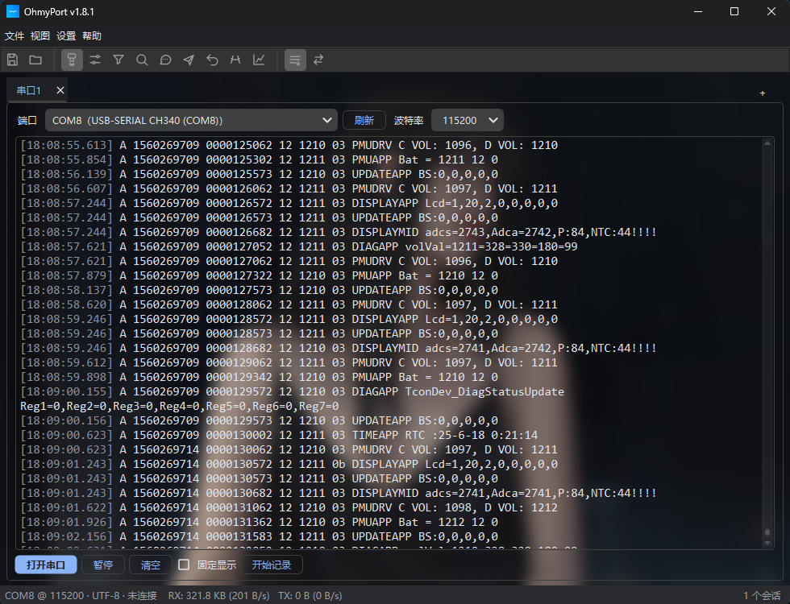

# OhmyPort

A standalone serial debugging tool built with Python + PySide6, supporting multiple serial ports in parallel.



## Download

Get the latest release from [Gitee Releases](https://gitee.com/Shine_Zhang/ohmy-port/releases). Each version ships in two forms:

| File | Type | Description |
| --- | --- | --- |
| `OhmyPort_v<version>.zip` | Portable (zip) | Extract to get the `OhmyPort` folder, then run `OhmyPort.exe` inside — no install needed; great for temporary use or a USB drive |
| `OhmyPort_Setup_v<version>.exe` | Installer | Runs the setup wizard, installs to Program Files, can create Start Menu and desktop shortcuts, supports uninstall |

> The portable build and the installer are **functionally identical**; they differ only in deployment.

## Features

- **Serial I/O**: true HEX send/receive, encoding selection (ASCII / UTF-8 / GBK), full serial parameters (data/stop/parity/flow control/DTR/RTS), baud rate selectable or custom-entered (right-click to delete custom entries), hot-plug auto detection
- **Escaped send**: supports `\r \n \t \0 \xNN \\` escape sequences; text and HEX can be mixed
- **Multi-port**: parallel monitoring of multiple serial ports in one window via tabs, each with independent parameters/display/filter/logging/stats; connected tabs show a green dot for at-a-glance status
- **Multi-keyword filter**: highlight / include-only / exclude / split-pane, plus search (Ctrl+F)
- **Protocol parsing**: custom header/tail/length field/checksum (SUM8/XOR8/CRC16-Modbus) auto framing with failure hints
- **Numerical plotting**: separate window, black line charts, custom extraction rules (regex capture group or keyword), time axis, missing-value hold
- **Logging**: auto-save on connect (COM port + timestamp naming), auto sharding (configurable size), millisecond timestamps, configurable directory and retention policy
- **Log display**: gray timestamps, cyan TX, gray system lines, theme-adaptive highlights, switchable monospace font, wrap toggle
- **High-throughput rendering**: batched insertion, inline keyword highlighting, and format caching keep it smooth at high baud rates (see Performance)
- **Send assist**: SSCOM-style commands (name + content), paged tabs (8 per page), timed cyclic send, right-click edit/delete; pages and commands are included in config export/import
- **Collapsible panels**: port connection config, keyword filter, keyword search, message send, send assist, serial params, auto reply, and protocol parsing can all be shown/hidden via the View menu or toolbar icons; the connection config auto-collapses after connecting and can be re-shown by right-clicking a serial tab
- **Auto reply**: keyword-triggered replies
- **Tools**: ASCII ↔ HEX bidirectional conversion
- **Background skin**: full-window background image with adjustable blur
- **Themes**: follow system / dark / eye-friendly / light (powered by qdarktheme; can auto-sync with OS light/dark)
- **UI polish**: main toolbar with theme-tinted SVG icons, status bar with live per-port stats, primary/secondary action styling, smooth panel expand/collapse
- **System tray**: minimize to tray on close (configurable default behavior / don't ask again)

## Install dependencies

```bash
pip install -r requirements.txt
```

> On Python ≥ 3.12, `pyqtdarktheme` needs `--ignore-requires-python`:
> `pip install -r requirements.txt --ignore-requires-python`

## Run

```bash
python serial_tool.py
```

## Build / package

On Windows (one-shot build + release artifacts):

```powershell
powershell -ExecutionPolicy Bypass -File build.ps1
```

Outputs:

- `dist\OhmyPort\` — build output (onedir folder, faster startup)
- `release\OhmyPort_v<version>\` — release directory
  - `OhmyPort\` — portable folder (exe + dependencies + user guide)
  - `OhmyPort_v<version>.zip` — portable zip (whole folder packed, extract and run)
  - `OhmyPort_Setup_v<version>.exe` — installer (requires Inno Setup 6; skipped if absent)

## Usage

1. Select port and baud rate, click "打开串口"; logging starts automatically on connect (disable via Settings → auto-save).
2. Type in the send box, press Enter or click "发送"; check "HEX发送" to send hex (e.g. `01 03 00 0A`).
3. View → "发送辅助" to add common commands (name + content); click to send, right-click to edit/delete; add pages to organize.
4. View → "数值绘图" to open the plot window and add extraction rules (e.g. `temp=(\d+\.?\d*)` or keyword `NTC`).
5. Settings → theme to switch follow-system / dark / eye-friendly / light.
6. Settings → "背景皮肤" to set the background image; the dialog shows the image directory — drop images there and click "刷新", or click "选择目录" to pick your own wallpaper folder.
7. Settings → retention policy to set log retention (week / month / half-year / year / unlimited; default one month).
8. Settings → export/import config to back up or share: includes global settings, all serial tab parameters, **and all send-assist command pages and commands** (name, content, page, cycle flag).

## Shortcuts

| Shortcut | Action |
| --- | --- |
| `Ctrl+F` | Show find bar (Esc to close) |
| `Ctrl+=` / `Ctrl+-` | Increase / decrease log font |
| `Ctrl+0` | Reset font size |
| `Ctrl+S` | Save current tab log |
| `Ctrl+Q` | Quit |

## Performance

The log view uses a ring buffer (50,000 lines by default, constant memory) and three render optimizations for high data volume:

- **Batched insertion**: a chunk of lines is merged into a single edit block to avoid per-line layout/repaint;
- **Inline highlighting**: keywords are colored once at insert time, removing the periodic full-document scan;
- **Format caching**: `QTextCharFormat` objects are reused by color to avoid high-frequency allocation.

Run the off-screen benchmark for local throughput:

```bash
python benchmark.py
```

At ~30 bytes per line (8N1), 921600 baud is roughly 3,000 lines/s; default settings handle about 30k+ lines/s plain and 15k+ lines/s with keyword highlighting — several times headroom.

## Project layout

```
ohmy-port/
├── serial_tool.py       # entry point + main UI (tabs, filter, send assist, themes, tray)
├── common.py            # constants & pure logic (LogFilter, byte formatting, data dir)
├── icons.py             # embedded SVG icon set (recolored per theme)
├── serial_worker.py     # serial read/write thread and queue
├── plot_widget.py       # numerical plotting (PlotRule / PlotWidget / PlotWindow)
├── log_manager.py       # log writing, sharding, retention cleanup
├── frame_parser.py      # protocol frame parsing (header/tail/length/checksum)
├── build.ps1            # PyInstaller build script
├── installer.iss        # Inno Setup install script
├── benchmark.py         # off-screen throughput benchmark
└── tests/               # pytest unit tests
```

## Development & tests

```bash
# run unit tests
python -m pytest tests -q

# off-screen throughput benchmark
python benchmark.py
```

## Data & config location

- Portable build: config, logs, background cache and images default to the **exe directory** (`serial_tool_config.json`, `Logs/`, `bg_cache/`, `background/`).
- If the exe directory is not writable (e.g. installed under Program Files), it falls back to `%APPDATA%\OhmyPort\`.
- The log directory can be customized via Settings → log directory.

## FAQ

- **Port open fails / access denied**: usually another program holds the port; close it and retry, or check permissions.
- **How to send HEX**: check "HEX发送", content like `01 03 00 0A` (space separated, optional `0x` prefix).
- **Where are logs**: right-click the log area → open log directory, or Settings → log directory.
- **Where is the config**: `serial_tool_config.json` next to the exe (or `%APPDATA%\OhmyPort\`).
- **Background image list is empty**: make sure images are placed in the `background/` directory shown in the dialog, then click "刷新".
- **"Unknown publisher" warning**: the portable build is unsigned; click "Run anyway".
- **Unexpected crash**: an `error.log` is written next to the exe; please send it to the developer.

## License

[GPL-2.0](LICENSE); dependency license compatibility is documented in [LICENSES.md](LICENSES.md).

## Version

- Version: 1.8.7
- Author: ShineZhang
- Date: 2026-11-12
