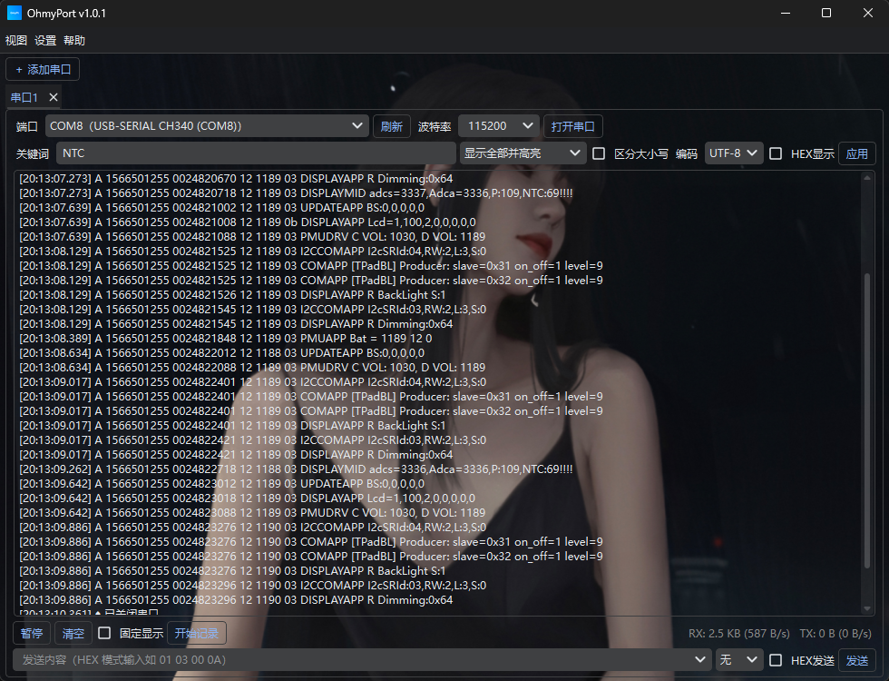

# OhmyPort

基于 Python + PySide6 的独立串口调试工具，支持多串口并行监听。



## 功能特性

- **串口收发**：真·HEX 收发、编码选择（ASCII / UTF-8 / GBK）、完整串口参数（数据位/停止位/校验位/流控/DTR/RTS）、端口热插拔自动检测
- **转义发送**：发送框支持 `\r \n \t \0 \xNN \\` 转义字符，文本与 HEX 可混写
- **多串口**：一个窗口内标签页并行监听多个串口，各串口参数/显示/过滤/记录/统计独立
- **多关键词过滤**：高亮 / 仅显示命中行 / 排除命中行 / 上下分栏显示命中行，支持查找（Ctrl+F）
- **协议解析**：自定义帧头/帧尾/长度字段/校验（SUM8/XOR8/CRC16-Modbus）自动切帧，校验失败提示
- **数值绘图**：独立窗口、黑底折线图、自定义提取规则（正则捕获组或关键词）、时间横轴、缺失保持上一值
- **日志**：连接后自动保存（COM口+时间戳命名）、自动分片（大小可配）、毫秒级时间戳、保存目录可配置、保留策略可配置
- **发送辅助**：SSCOM 式命令（名称+内容）、页签分页（每页 8 个）、定时循环发送、右键编辑/删除
- **自动应答**：按关键词自动回复
- **工具**：ASCII ↔ HEX 双向转换
- **背景皮肤**：整窗口背景图（可调模糊强度）
- **主题**：深色 / 护眼 / 白天（基于 pyqtdarktheme）

## 安装依赖

```bash
pip install -r requirements.txt
```

> 若 Python ≥ 3.12，`pyqtdarktheme` 需加 `--ignore-requires-python`：
> `pip install -r requirements.txt --ignore-requires-python`

## 运行

```bash
python serial_tool.py
```

## 打包发布

Windows 下执行（一键打包 + 生成发布产物）：

```powershell
powershell -ExecutionPolicy Bypass -File build.ps1
```

产物：

- `dist\OhmyPort.exe` — 构建输出
- `release\OhmyPort_v<版本>\` — 发布目录
  - `OhmyPort.exe` — 免安装绿色版
  - `OhmyPort_v<版本>.zip` — 绿色版压缩包
  - `OhmyPort_Setup_v<版本>.exe` — 安装包（需安装 Inno Setup 6，未安装则跳过）

## 使用说明

1. 选择端口和波特率，点击「打开串口」；连接成功后自动开始保存日志（可在「设置 → 连接后自动保存日志」关闭）。
2. 发送区输入内容，回车或点「发送」；勾选「HEX发送」可发送十六进制（如 `01 03 00 0A`）。
3. 「视图 → 发送辅助」添加常用命令（名称+内容），点击按钮即发送，右键按钮编辑/删除。
4. 「视图 → 数值绘图」打开绘图窗口，添加提取规则（如 `temp=(\d+\.?\d*)` 或关键词 `NTC`），实时绘制曲线。
5. 「视图 → 主题」切换深色 / 护眼 / 白天。
6. 「设置 → 背景皮肤」设置整窗口背景图；对话框会显示图片存放目录，把图片放进去后点「刷新」即可选择。
7. 「设置 → 日志保留策略」设置日志保留时长（一周 / 一个月 / 半年 / 一年 / 无限制，默认一个月，到期自动清理）。
8. 「设置 → 导出配置 / 导入配置」备份或团队共享命令页与串口参数。

## 数据与配置位置

- 绿色版：配置、日志、背景缓存、背景图默认放在 **exe 同级目录**（`serial_tool_config.json`、`Logs/`、`bg_cache/`、`background/`）。
- 若 exe 所在目录不可写（如安装到 Program Files），会自动切换为 `%APPDATA%\OhmyPort\`。
- 日志保存目录可在「设置 → 日志保存目录」自定义。

## 常见问题（FAQ）

- **串口打开失败 / 提示拒绝访问**：通常是被其它软件占用（如另一个串口助手、驱动冲突），关闭占用程序后重试；也可能是无权限。
- **HEX 怎么发**：勾选「HEX发送」，内容形如 `01 03 00 0A`（空格分隔，可带 `0x` 前缀）。
- **日志在哪**：右键日志区 →「打开日志目录」，或「设置 → 日志保存目录」查看/修改。
- **配置在哪**：exe 同级的 `serial_tool_config.json`（或 `%APPDATA%\OhmyPort\`）。
- **背景图不显示列表**：确认图片已放入「背景皮肤」对话框里提示的 `background/` 目录，然后点「刷新」。
- **打开提示「未知发布者 / 已保护你的电脑」**：绿色版未做代码签名，属正常现象，点「仍要运行」即可。
- **程序异常退出**：会在 exe 同级生成 `error.log`，请把该文件反馈给开发者。

## 版本信息

- 版本：1.4.1
- 作者：ShineZhang
- 日期：2026-09-07
